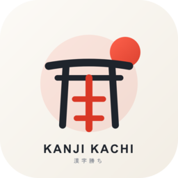

# 🏯 Kanji Kachi (漢字勝ち) · Web Edition

<div align="center">
  
  <h3>Rèn luyện phản xạ Hán tự JLPT N5 & N4</h3>
  <p>Phong cách <strong>Modern Sumi & Paper</strong> — Tinh hoa Mực tàu & Giấy Washi Nhật Bản</p>
</div>

---

## 🌟 Tổng quan
**Kanji Kachi** là nền tảng luyện phản xạ Hán tự tiếng Nhật tốc độ cao, được đồng bộ giao diện và dữ liệu trực tiếp từ ứng dụng di động Kanji Kachi. Với thiết kế tối giản, thanh lịch, ứng dụng mang đến trải nghiệm học tập tập trung, không phân tâm và hỗ trợ đầy đủ trên cả máy tính (Desktop) lẫn điện thoại (Mobile Web).

## 🚀 Tính năng nổi bật

### 1. Thư viện 1.275 Hán tự & Bộ thủ
- **350 chữ N5**: 8 chủ đề (Số đếm & Tiền tệ, Thời gian & Lịch, Con người & Gia đình, Phương hướng, Giao thông, Trường học, Ẩm thực, Thiên nhiên & Màu sắc).
- **711 chữ N4**: 11 chủ đề chuyên sâu (Gia đình mở rộng, Bốn mùa & Thời tiết, Ẩm thực & Nhà hàng, Sở thích & Thể thao, Đô thị & Du lịch, Sức khỏe & Bệnh viện, v.v.).
- **214 Bộ thủ Khang Hy (Radicals)**: Phân loại theo số nét (1 nét đến 17 nét) kèm nghĩa và ví dụ ghép chữ.

### 2. Bộ chuyển đổi Romaji ➔ Hiragana mượt mà
- Tự động chuyển đổi trực tiếp ngay khi gõ (`sakana` ➔ `さかな`, `gakkou` ➔ `がっこう`, `densha` ➔ `でんしゃ`).
- Không cần cài đặt hay chuyển đổi bộ gõ IME tiếng Nhật trên máy tính.

### 3. Ba chế độ rèn luyện linh hoạt
1. **Gõ Hiragana + Chọn nghĩa (Khuyên dùng)**: Gõ đúng Hiragana ➔ Khóa ô nhập ➔ Hiện 4 lựa chọn nghĩa tiếng Việt ➔ Bấm phím `1`, `2`, `3`, `4`.
2. **Chỉ gõ Hiragana (Tốc độ cao)**: Tắt hoàn toàn trắc nghiệm, gõ đúng âm đọc là tự động chuyển ngay sang câu kế tiếp.
3. **Hiện cả hai cùng lúc**: Hiển thị đồng thời ô gõ và trắc nghiệm 4 đáp án.

### 4. Hệ thống phím tắt bàn phím tiện lợi
- **`1`, `2`, `3`, `4`**: Chọn nhanh đáp án nghĩa trắc nghiệm.
- **`Ctrl + Z`** (hoặc nút **⬅️ Quay lại**): Quay lại câu trước đó nếu bấm nhầm.
- **`Ctrl + G`** (hoặc nút **⊞ Chọn câu**): Mở bảng lưới câu hỏi để nhảy nhanh đến câu bất kỳ.
- **`Space`**: Phát âm chuẩn giọng bản xứ Tokyo (Web Speech API).
- **`💡 Gợi ý`**: Hiển thị chữ cái đầu tiên của âm đọc.
- **`🔖 Đánh dấu`**: Lưu vào sổ tay từ chưa nhớ để ôn luyện riêng.

### 5. Thẻ ghi nhớ Flashcard 3D
- Hiệu ứng lật thẻ 3D mượt mà xem Hán tự ➔ Âm đọc Hiragana, Hán Việt, Ý nghĩa và Từ ghép ví dụ.
- Nút phát âm trực tiếp trên thẻ.

### 6. Lưu trữ tiến độ học tập Offline (LocalStorage)
- Ghi nhận chuỗi ngày học liên tục (Streak 🔥).
- Thống kê tỷ lệ chính xác (%), tổng số chữ đã thuộc và danh sách các chữ cần ôn lại.

---

## 🛠️ Công nghệ sử dụng
- **HTML5 & Vanilla JavaScript (ES6+)**: Chạy siêu nhanh, không phụ thuộc framework nặng nề.
- **Tailwind CSS**: Thiết kế theo hệ thống màu sắc **Modern Sumi & Paper** (`#fbf9f5` Washi Cream, `#080d13` Sumi Indigo, `#b52517` Vermilion Red).
- **Web Speech API**: Giọng phát âm tiếng Nhật `ja-JP` chuẩn xác không cần server backend.
- **Google Fonts**: `Noto Serif` & `Plus Jakarta Sans`.

---

## 🚢 Triển khai (Deploy)
Dự án là trang tĩnh 100%, bạn có thể deploy lên **Vercel**, **GitHub Pages**, **Cloudflare Pages** hoặc **Netlify** bằng cách đẩy lên GitHub:
```bash
git add .
git commit -m "feat: port Kanji Kachi mobile app to web with Sumi & Paper design"
git push origin master
```
